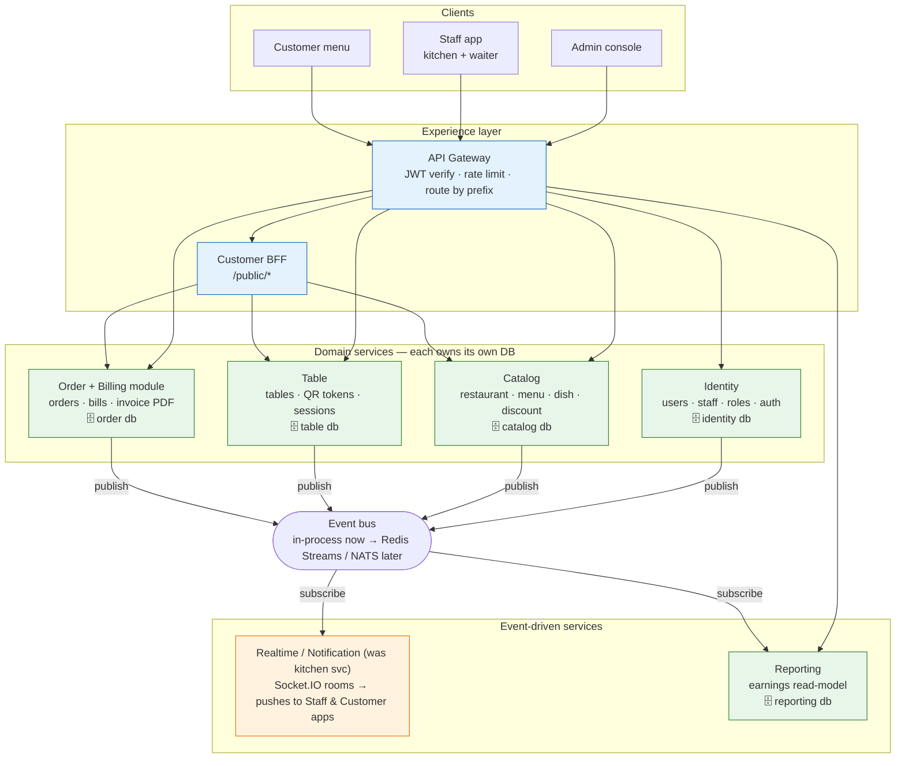
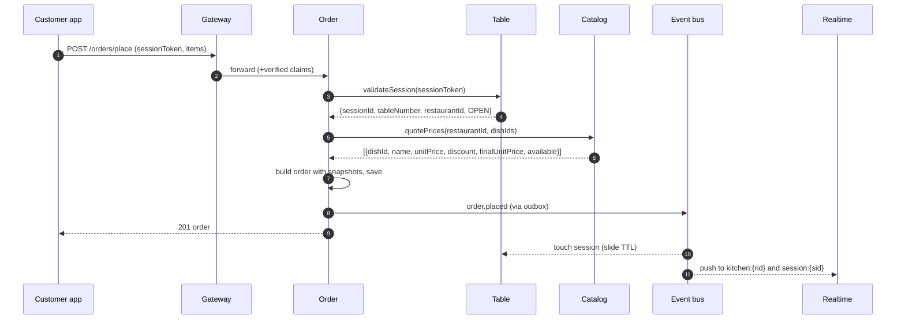
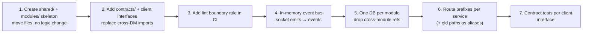

# QR Menu — Service Boundaries (microservice-ready modular monolith)

**Goal:** keep shipping a single deployable now, but structure it so any module can later be lifted
out into its own microservice **without rewriting business logic**. This document defines:

1. Which services exist and what each one is responsible for.
2. Which service **owns** which collection (table), and who may read/write it and how.
3. Which APIs each service exposes, and how services talk to each other.
4. The code rules that keep the monolith splittable, and the migration steps from today's code.

Companion doc: [SYSTEM_DESIGN.md](./SYSTEM_DESIGN.md).

---

## 1. Proposed service split vs. our first idea

Our first idea was *admin, kitchen, customer, order, table, user*. Three of those (**admin, kitchen,
customer**) are named after **who uses the app**, not after **what data they own**. Splitting by user
type forces services to share tables. For example, admin writes dishes, customer reads dishes and
order validates dishes, so all three would need the `dishes` collection. That's a distributed monolith.

Rule of thumb: **a microservice = one business capability + the data it alone owns.** User-facing
needs are handled by a thin **experience layer** (gateway/BFF) that calls the domain services.

| First idea | Recommendation | Why |
|---|---|---|
| **user service** | ✅ **Identity service** | Users, staff, roles, login, tokens: one clear owner. |
| **admin service** | 🔁 Rename → **Catalog service** (restaurant + menu) | What "admin" actually manages is restaurant profile, menu, categories, dishes, discounts, tax config. Admin *screens* also touch tables/orders/bills, which belong elsewhere. |
| **table service** | ✅ **Table service** (keep it: tables + QR + table sessions) | Table sessions (TTL, who's sitting where, QR tokens) are a real, independent lifecycle. Order and billing both depend on it. |
| **order service** | ✅ **Order service** (+ **Billing** module inside it at first) | Orders and bills change together (a bill is built from a session's orders). Start as two modules in one service; split Billing out only if needed. |
| **kitchen service** | 🔁 → **Realtime / Notification service** | The kitchen owns no data; it *views* orders and *changes status* through Order service. The independent part is the push channel (Socket.IO rooms, sounds, waiter alerts), which is stateless and the easiest first extraction. |
| **customer service** | 🔁 → **Customer BFF** (in the API gateway) | Customer identity lives in Identity and the table session in Table service. What's left is composition ("menu + table + my orders + my bill" in one call), which is a BFF's job. |
| *(not in list)* | ➕ **Reporting service** (later) | Earnings/analytics = a read-only model built from events. It never queries other services' DBs. |

### Final map



---

## 2. Service responsibility cards

### 2.1 Identity service
- **Does:** Google SSO, PIN login for staff, issuing/refreshing JWTs, super-admin role, staff memberships (ADMIN / KITCHEN / WAITER per restaurant), staff invites.
- **Does NOT:** know anything about menus, tables or orders. Stores `restaurantId` only as an opaque ID.
- **Owns:** `users`, `staff_memberships`, `staff_invites`, `refresh_tokens`.

### 2.2 Catalog service (the "admin service" idea)
- **Does:** restaurant onboarding/profile/GPS/tax config/status, single menu + theme, categories, dishes, discounts, availability, image upload URLs (Cloudinary), effective-price calculation.
- **Does NOT:** decide whether an order is allowed; that's Order's job, using Catalog's price quote.
- **Owns:** `restaurants`, `menus`, `categories`, `dishes`.

### 2.3 Table service
- **Does:** tables, QR token generation/rotation, activate/deactivate, **table sessions** (open, join via QR, TTL, request bill, close), GPS proximity check at join time, live table status grid.
- **Does NOT:** store orders or money.
- **Owns:** `tables`, `table_sessions`.

### 2.4 Order service (+ Billing module)
- **Order module does:** place order (validates session with Table and prices with Catalog), status state machine, kitchen/waiter queries, per-session order list.
- **Billing module does:** generate bill from a session's eligible orders, tax/service charge/round-off, sequential bill numbers, mark paid / void, PDF & print view.
- **Owns:** `orders` (Order); `bills`, `bill_counters` (Billing).

### 2.5 Realtime / Notification service (the "kitchen service" idea)
- **Does:** Socket.IO connections, authenticates socket handshakes (staff JWT or customer session token), maps events → rooms (`kitchen:{rid}`, `staff:{rid}`, `session:{sid}`), new-order sound triggers, waiter "ready"/"bill requested" alerts.
- **Does NOT:** write business data. Kitchen status changes go `Staff app → Gateway → Order service`.
- **Owns:** nothing persistent (optional `device_tokens` for kitchen tablets).

### 2.6 Reporting service (later)
- **Does:** consumes `bill.paid`, `order.status_changed` and builds daily/weekly earnings, top dishes, per-table/per-waiter stats.
- **Owns:** `rpt_daily_sales`, `rpt_dish_sales`, `rpt_staff_sales` (all derived, rebuildable).

### 2.7 Customer BFF (inside the gateway)
- **Does:** one-call composition for the customer app: `getMenuForSession` (Catalog + Table), `getMySession` (Table + Order + Billing).
- **Owns:** nothing. Stateless.

---

## 3. Data ownership matrix — who can touch which table

**Golden rule:** a collection is read and written **only** by its owner service. Everyone else uses
the owner's API (sync) or keeps its **own local copy** updated from the owner's events (async).
No shared collections, no cross-service joins/`populate`/`$lookup`.

Legend: **W** = owner (read+write) · **API** = may call owner's API · **EVT** = keeps a local copy from events · — = no access

| Collection | Owner | Identity | Catalog | Table | Order | Billing | Realtime | Reporting |
|---|---|:-:|:-:|:-:|:-:|:-:|:-:|:-:|
| `users` | Identity | **W** | — | — | — | — | — | — |
| `staff_memberships` | Identity | **W** | — | — | — | — | — | EVT (waiter names) |
| `restaurants` | Catalog | API (onboarding) | **W** | EVT (GPS, ttl) | — | EVT (tax, name, address) | — | EVT (name) |
| `menus` / `categories` | Catalog | — | **W** | — | — | — | — | — |
| `dishes` | Catalog | — | **W** | — | API (price quote) | — | — | EVT (name) |
| `tables` | Table | — | — | **W** | — | — | — | EVT (number) |
| `table_sessions` | Table | — | — | **W** | API (validate) | API (close on paid) | — | — |
| `orders` | Order | — | — | — | **W** | API (in-service) | — | EVT |
| `bills`, `bill_counters` | Billing | — | — | — | — | **W** | — | EVT |
| `rpt_*` | Reporting | — | — | — | — | — | — | **W** |

**Snapshots instead of joins.** When a service needs another service's data *at the moment of a
write*, it copies it into its own document. Today's `Order` already does this (`dishName`, `price`,
`tableNumber`), and we keep the pattern:

| Document | Snapshots |
|---|---|
| `orders.items[]` | `dishName`, `unitPrice`, `discount`, `finalUnitPrice` (from Catalog quote) |
| `orders` | `tableNumber`, `sessionId` (from Table) |
| `bills` | `restaurantName`, `address`, `gstin`, `taxConfig` at bill time (from Catalog copy) |
| `table_sessions` | nothing from others, only IDs |

**IDs across services are plain strings** (no Mongoose `ref:` to another service's model).

---

## 4. API ownership

Every route belongs to exactly one service. The URL prefix tells you the owner, so the gateway can
route by prefix when services are split out.

| Service | Prefix | Endpoints (current → target) | Callers |
|---|---|---|---|
| Identity | `/api/v1/identity` | `auth/google`, `auth/google/callback`, `auth/pinLogin`, `auth/logout`, `me`, `staff/invite`, `staff/list`, `staff/update/:id`, `staff/remove/:id` | Admin, Staff |
| Catalog | `/api/v1/catalog` | `restaurant/*` (register→onboard, update, setGps, setTax, setStatus), `menu/*`, `category/*`, `dish/*` (+ `setDiscount`), `upload/*` | Admin; Super admin |
| Catalog (internal) | `internal` | `quotePrices(restaurantId, dishIds[])` → effective prices + availability | Order |
| Table | `/api/v1/tables` | `table/add`, `addBulk`, `getAll`, `delete`→`setActive`, `rotateQr`, `qr/get`; `session/join`, `session/me`, `session/requestBill`, `session/open`, `session/close`, `live` | Admin, Staff, Customer |
| Table (internal) | `internal` | `validateSession(sessionToken)` → `{sessionId, tableId, tableNumber, restaurantId, status}` | Order, Billing |
| Order | `/api/v1/orders` | `place`, `getStatus/:id`, `listMine`, `listBySession/:sid`, `kitchen` (was `getKitchenOrders`), `getAll`, `setStatus/:id` | Customer, Staff, Admin |
| Billing | `/api/v1/billing` | `generate`, `get/:id`, `pdf/:id`, `print/:id`, `markPaid/:id`, `void/:id`, `mine` (was `invoice/*`) | Staff, Admin, Customer |
| Reporting | `/api/v1/reports` | `earnings`, `topDishes`, `byTable`, `byWaiter` | Admin, Super admin |
| Customer BFF | `/api/v1/public` | `getMenu` (was `getMenu/:rid/:tid`), `getMySession` | Customer |
| Realtime | `ws://…/realtime` | rooms `kitchen:{rid}`, `staff:{rid}`, `session:{sid}` | Staff, Customer, Admin |

`internal` APIs are **not** exposed through the gateway. In the monolith they are plain function
calls through the module's client interface; after the split they become HTTP/gRPC with a
service-to-service token.

---

## 5. How services talk

### 5.1 Synchronous calls (needed to answer *right now*)



Keep sync chains **≤ 2 hops**. If Order needs Catalog *and* Table, call them in parallel.

### 5.2 Asynchronous events (everything else)

| Event | Producer | Consumers | Payload (key fields) |
|---|---|---|---|
| `restaurant.onboarded` / `restaurant.updated` | Catalog | Identity (link owner), Table (GPS, TTL copy), Billing (tax/name copy), Reporting | `restaurantId, name, address, gps, gpsRadius, taxConfig, sessionTtl, status` |
| `dish.updated` | Catalog | Reporting | `dishId, name, categoryId` |
| `staff.added` / `staff.removed` | Identity | Reporting, Realtime | `userId, restaurantId, role, displayName` |
| `table.updated` | Table | Reporting | `tableId, tableNumber, isActive` |
| `session.opened` / `session.bill_requested` / `session.closed` / `session.expired` | Table | Realtime, Order (block new orders after close) | `sessionId, tableId, restaurantId, status` |
| `order.placed` | Order | Realtime, Table (activity), Reporting | `orderId, sessionId, restaurantId, tableNumber, items, total` |
| `order.status_changed` | Order | Realtime, Reporting | `orderId, sessionId, restaurantId, from, to, by` |
| `bill.generated` | Billing | Realtime, Table (→ BILLED) | `billId, sessionId, grandTotal` |
| `bill.paid` / `bill.voided` | Billing | Table (→ CLOSED), Reporting | `billId, sessionId, restaurantId, grandTotal, paymentMode, paidAt, waiterId` |

Every event has an envelope: `{ id, type, version, occurredAt, restaurantId, payload }`.
Consumers are **idempotent** (they store processed `id`s). Producers use an **outbox**: write
the event to their own `outbox` collection in the same DB write, and a relay publishes it.
Today's direct `emitNewOrder(...)` call in `order.controller.ts` becomes `order.placed` on the bus.

---

## 6. Code structure inside the monolith

> **Implemented (current):** `server/src/services/<service>/` for auth, restaurant, menu, table, order,
> billing, staff, upload, realtime, super-admin — see [PROGRESS.md §6](./PROGRESS.md). The layout below is
> the longer-term target (shared kernel, events, per-module contracts).

```
server/src/
├── shared/                         # Shared kernel: NO business logic
│   ├── http/        (response util, asyncHandler, error middleware)
│   ├── auth/        (verifyJwt, requireRole, tenantScope; claims type)
│   ├── events/      (IEventBus, envelope type, in-memory bus, outbox relay)
│   ├── db/          (createModuleConnection(name))
│   └── logger.ts, env.ts
├── modules/
│   ├── identity/
│   │   ├── api/            routes, controllers, validators     (HTTP only)
│   │   ├── application/    identity.service.ts                  (use cases)
│   │   ├── dm/             *.model.ts, *.dm.ts                  (DB only, private!)
│   │   ├── events/         handlers for events it consumes
│   │   └── contracts/      index.ts: DTOs, event types, IIdentityClient   ← the ONLY public surface
│   ├── catalog/   (same shape)
│   ├── table/
│   ├── order/     (order + billing sub-folders, separate contracts)
│   ├── realtime/  (socket gateway, event→room mapping)
│   └── reporting/
├── bff/customer/                   # composition routes for /public/*
└── app.ts / server.ts              # mounts each module's router under its prefix
```

**The five rules (enforced, not just documented):**

| # | Rule | How we enforce it |
|---|---|---|
| 1 | A module may import only `shared/**` and **other modules' `contracts/`** | ESLint `no-restricted-imports` (or `dependency-cruiser`) in CI: `modules/*/dm/**`, `modules/*/application/**` are forbidden from outside their module |
| 2 | Each module uses **its own Mongo connection/database** (`qr_identity`, `qr_catalog`, `qr_table`, `qr_order`, `qr_reporting`) | `createModuleConnection('catalog')`; models are registered on that connection, not the global `mongoose` |
| 3 | Cross-module calls go through a **client interface** in `contracts/` (e.g. `ICatalogClient.quotePrices`) | Now: `InProcessCatalogClient` calls the service directly. Later: `HttpCatalogClient` with the same interface. Wired in one composition root |
| 4 | Side-effects in other modules happen through **events**, not direct calls | Module code calls `eventBus.publish(...)`; never imports another module's service to "notify" it |
| 5 | No cross-module transactions | Use events + idempotent handlers. Inside one module, transactions are fine |

With these rules, extracting a service = copy `modules/<x>` + `shared` into a new repo/process,
swap `InProcess*Client` → `Http*Client`, swap in-memory bus → real broker. No business code changes.

**Per-user-type folders (in use now).** Each user type gets its own experience-layer folder with its own
API surface, while the data stays owned by the domain DMs:

```
server/src/services/<user-type>/       e.g. services/super-admin/ (built)
├── routes/        <user-type>.routes.ts      mounted at /api/v1/<user-type>
├── controllers/   <user-type>.controller.ts  composes DM calls, no direct model access
├── validators/    zod schemas
├── middlewares/   access check (e.g. requireSuperAdmin)
├── interfaces/    response/request types for this API
├── constants/     route paths, messages, limits
└── index.ts       exports the router only
client/<user-type>/                    e.g. client/super-admin/ → served at host/super-admin/
```

The super admin service reads and writes restaurants only through `dm/restaurant` (plus read-only
counts from the user/menu/dish/table/order DMs). Admin, kitchen and customer code will move into
`services/admin`, `services/kitchen` and `services/customer` the same way.

---

## 7. Where today's code crosses boundaries (to fix during refactor)

| File | Crossing | Fix |
|---|---|---|
| `dm/order/order.dm.ts` | imports `DishDM`, `TableDM` | `catalogClient.quotePrices()`, `tableClient.validateSession()` |
| `dm/invoice/invoice.dm.ts` | imports `OrderDM`, `RestaurantDM`, `TableDM` | Billing reads orders in-service; restaurant info from local copy (`restaurant.updated` events); `tableNumber` from order snapshot |
| `routes/public.routes.ts` | imports 5 DMs directly | Becomes `bff/customer`, calls `catalogClient` + `tableClient` |
| `dm/menu/menu.dm.ts` | imports `RestaurantDM` | Same module (Catalog), OK |
| `controllers/restaurant.controller.ts` | imports `UserDM` to link owner | Catalog publishes `restaurant.onboarded`; Identity handles it |
| `controllers/qr.controller.ts` | imports `RestaurantDM` | Not needed: table already has `restaurantId`; QR encodes token only |
| `middlewares/gps.middleware.ts` | imports `RestaurantDM` | Moves to Table service (`session/join`), uses local GPS copy |
| `controllers/order.controller.ts` | calls `emitNewOrder` (socket) directly | Publish `order.placed`; Realtime subscribes |
| Models with `ref:` to other modules (`order→Dish/Restaurant/Table`, `table→Restaurant`, `menu→Restaurant`, `user→Restaurant`, `restaurant→User`) | Mongoose refs across services | Plain `string` IDs (keep `ref` only inside a module, e.g. `dish→category`) |

Good news: there are **no `populate()` or `$lookup` calls** today, so no cross-collection joins need untangling.

---

## 8. Migration plan (fits into Phase 0 of SYSTEM_DESIGN.md)



**Extraction order later** (easiest/most valuable first): **Realtime** (stateless, scales separately
for sockets) → **Reporting** (read-only) → **Identity** → **Order+Billing** → **Table** → **Catalog**.

---

## 9. Decisions to confirm

1. **Service names/split**: go with *Identity, Catalog, Table, Order (+Billing), Realtime, Reporting* + *Customer BFF*, instead of *admin/kitchen/customer* services?
2. **Billing**: keep it inside Order service until there's a reason to split?
3. **Database per module from day 1** (same Mongo cluster, separate DB names)? Recommended: it's the cheapest way to make boundaries impossible to cheat.
4. **Broker for later**: Redis Streams (simple, also usable for Socket.IO adapter) vs NATS vs RabbitMQ.
