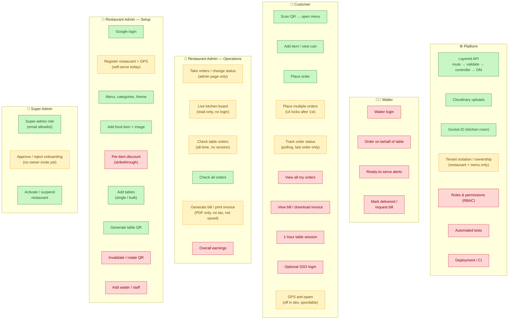
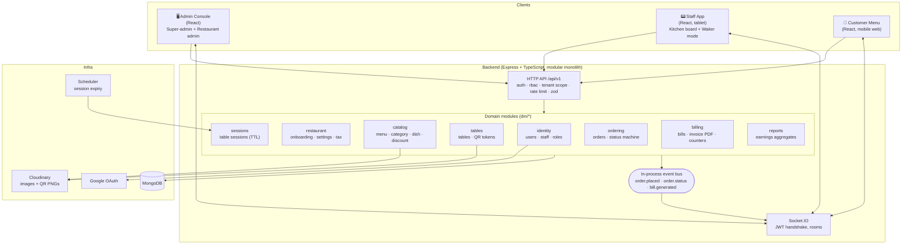
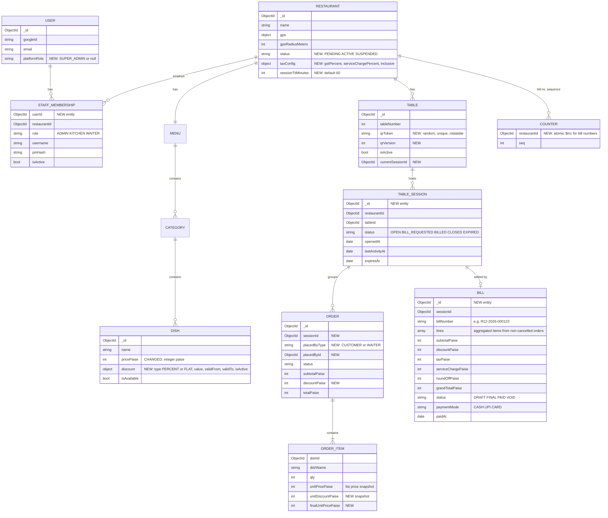
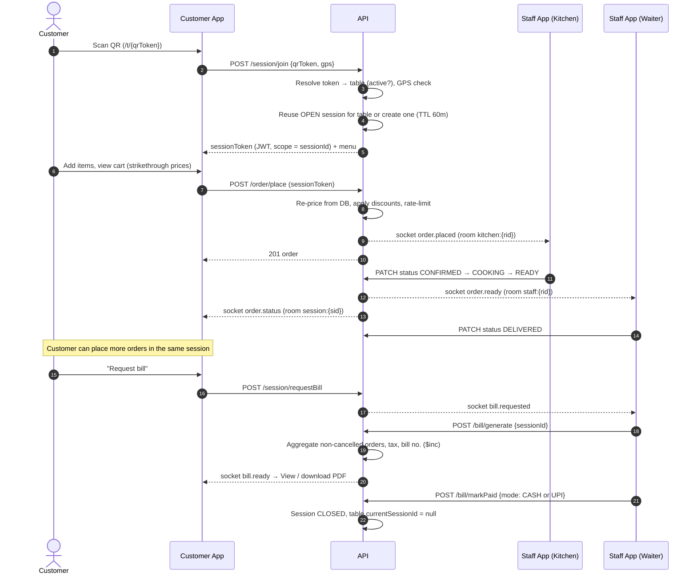
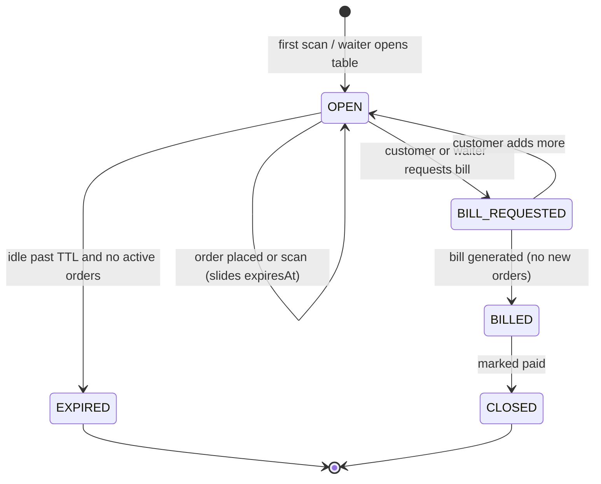
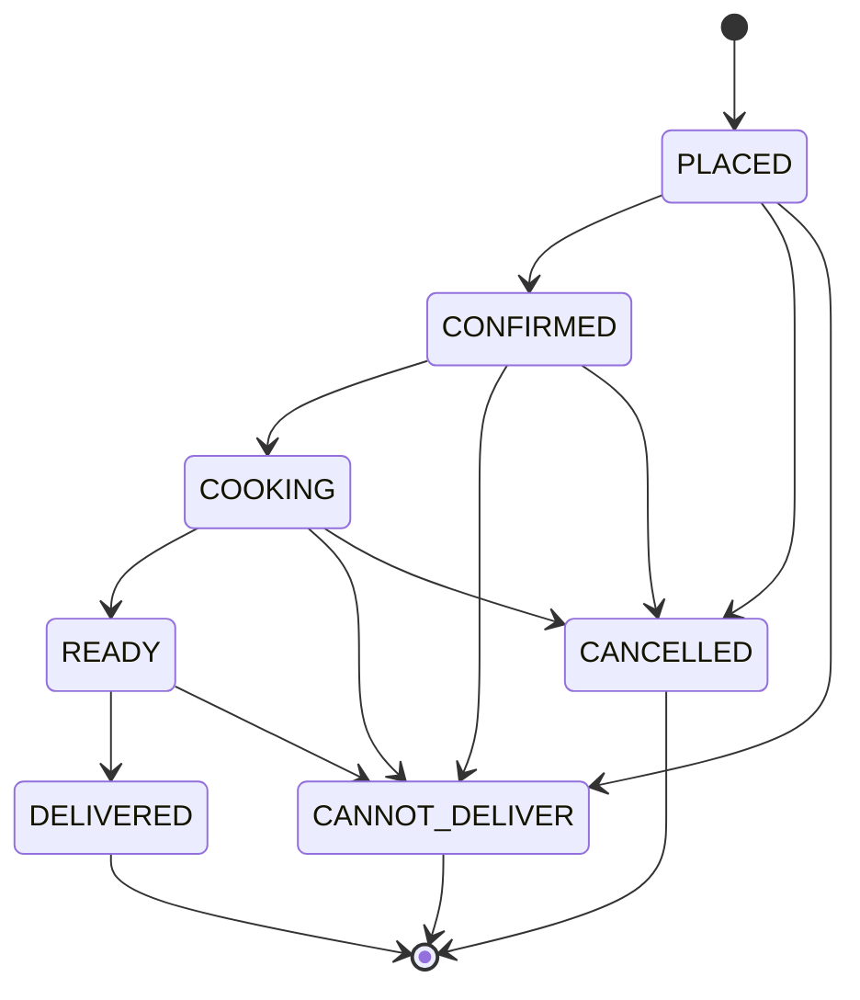
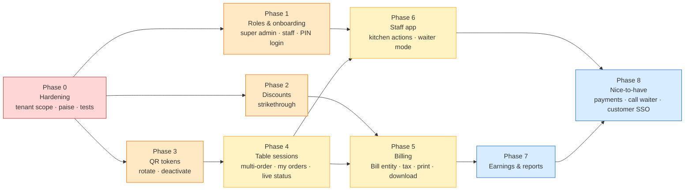

# QR Menu — System Design (v3)

This document has two parts:

1. **Where we are** – what the prototype already does vs. the requirements (HLD notebook page).
2. **Where we're going** – the target system design, broken into phases we can build piece by piece.

> Diagrams are Mermaid. They render on GitHub, and in VS Code with the
> "Markdown Preview Mermaid Support" extension.
>
> Service boundaries, data ownership and the future microservice split are in
> [SERVICE_BOUNDARIES.md](./SERVICE_BOUNDARIES.md).

---

## 1. Requirements (from the HLD)

| Actor | Needs |
|---|---|
| **Super Admin** (us, 1–2 users) | Onboard a restaurant/kitchen |
| **Restaurant Admin / Kitchen** | Make menu, add food item, discount, add tables + generate QR (and invalidate a table's QR), take orders, check a table's orders, check all orders, generate bill, print invoice, overall earnings, add waiter |
| **Customer** (session TTL ≈ 1 hour) / **Waiter** | Open menu (optional SSO login), add item, view cart, place **multiple** orders, view orders, download invoice |

---

## 2. Current status — what's built vs. what's missing

Legend: 🟩 done · 🟨 partial / has gaps · 🟥 not started

**Super admin (built):** `client/super-admin` (served at `/super-admin/`) + `server/src/services/super-admin/`. Access is an
email allowlist (`SUPER_ADMIN_EMAILS`). Restaurants now carry `status` (`PENDING_APPROVAL` → `ACTIVE` /
`REJECTED`, `ACTIVE` ⇄ `SUSPENDED`) with a `statusHistory` audit trail; only `ACTIVE` restaurants serve
their menu or accept orders. Restaurants created before this have no `status` and are treated as `ACTIVE`.

### 2.1 What exists today (code map)

| Area | Where | Notes |
|---|---|---|
| Server (Express + TS + Mongo) | `server/src` | Clean `routes → validators → controllers → dm` layering, zod validation, constants. |
| Auth | `auth.controller.ts`, `auth.middleware.ts` | Google OAuth → JWT cookie. One user = one restaurant, **no roles**. |
| Restaurant | `dm/restaurant` | Register / update / GPS / deactivate. Owner check ✅. |
| Menu, Category, Dish | `dm/menu`, `dm/category`, `dm/dish` | CRUD, reorder, availability toggle, theme. **No discount fields.** |
| Tables + QR | `dm/table`, `qr.controller.ts` | Add / bulk add / delete. QR encodes `/menu/{restaurantId}/{tableId}` (raw IDs – cannot be rotated). `isActive` exists but nothing toggles it. |
| Orders | `dm/order` | Place (server re-prices from DB ✅), status state machine, kitchen 30-min window, Socket.IO emit. |
| Invoice | `dm/invoice/invoice.dm.ts` | On-the-fly PDF per order and per table. Table PDF sums **every order ever** for that table, including cancelled ones. No tax, no bill number sequence, nothing persisted. |
| Admin app | `client/admin` | Dashboard, Restaurant, Menu Builder, Tables (+QR), Orders (status + PDF), Settings (theme). |
| Customer app | `client/menu` | Menu → cart → place order → status screen (polls). No way back to the menu, no order list, no bill. |
| Kitchen app | `client/kitchen` | Real-time read-only board via `?restaurant=<id>`. **No auth.** |

### 2.2 Gaps to fix before building on top (found while reviewing)

1. **Missing ownership checks** – category, dish, table, QR, order, invoice and upload routes only check *"is logged in"*, not *"owns this restaurant"*. Any logged-in Google user can read or modify another restaurant's data or download its invoices.
2. **Public data exposure** – `getKitchenOrders/:restaurantId` and `getActiveByTable/:tableId` are unauthenticated; anyone with an ID can see orders. *(Status: `getActiveByTable` removed — diners read their table via the authenticated table-session API. Kitchen board still open.)*
3. **QR cannot be invalidated** – it encodes raw Mongo IDs. A leaked or photographed QR works forever (subject to GPS only). *(Status: fixed — QR encodes `/menu/t/<qrToken>`, rotated by "Regenerate QR".)*
4. **Table bill is wrong once a table is reused** – no concept of a "visit"/session, so the table invoice includes previous customers' and cancelled orders. *(Status: fixed — table sessions; a bill closes the session.)*
5. **Money as floats** – totals use JS floating-point; store integer paise instead.
6. **GPS check is client-trusted** and disabled when `NODE_ENV=development`.
7. Admin Orders UI transitions differ slightly from the server's state machine (e.g. cancel from COOKING), and the Dashboard "Add Tables" step is hard-coded to incomplete.

---

## 3. Target architecture

**Key decisions**

| Decision | Why |
|---|---|
| Stay a **modular monolith** (one Express app, separate `dm/*` modules talking via function calls + a small in-process event bus) | Small team and low traffic; modules can be split out later because they don't share models directly. |
| **3 front-ends**: Admin, Staff (kitchen + waiter), Customer | The kitchen app becomes the Staff app with a login and two modes. Keeps the app count the same. |
| **Every tenant-owned document carries `restaurantId`**; a `tenantScope` middleware puts it on `req` and every DM query filters by it | Fixes gap #1 structurally rather than with per-route checks. |
| **Money in integer paise** | Avoids rounding errors in bills/tax. |
| Customer is **anonymous by default** (session token), SSO optional | Ordering shouldn't need a login; SSO can be added for order history/loyalty. |

---

## 4. Roles & permissions

| Capability | Super Admin | Restaurant Admin | Kitchen | Waiter | Customer (session) |
|---|:-:|:-:|:-:|:-:|:-:|
| Onboard / suspend restaurant | ✅ | | | | |
| Restaurant settings, GPS, tax | | ✅ | | | |
| Menu / dish / discount | | ✅ | | | |
| Tables, QR generate / rotate | | ✅ | | | |
| Add / remove staff | | ✅ | | | |
| See kitchen board, change cooking status | | ✅ | ✅ | | |
| Place order for a table | | ✅ | | ✅ | ✅ (own table) |
| Mark delivered, request bill | | ✅ | | ✅ | |
| Generate / print / void bill | | ✅ | | ✅ (generate/print) | |
| View & download own bill | | | | | ✅ |
| Earnings & reports | ✅ (platform) | ✅ | | | |

Implementation: `User.platformRole` (`SUPER_ADMIN` or none) + `StaffMembership { userId, restaurantId, role: ADMIN | KITCHEN | WAITER }`. JWT carries `userId`, `restaurantId`, `role`. Middleware: `requireAuth → requireRole([...]) → tenantScope`.

**Staff login:** Admins use Google SSO. Kitchen/waiters may not have Google accounts → support **restaurant code + username + PIN** (hashed with bcrypt) as a second login method. *(Open question – see §10.)*

---

## 5. Data model (target)

New entities/fields are marked **NEW**.

**Discount rule:** `finalUnitPrice = max(0, price − (PERCENT ? price × value / 100 : value))`, applied only when `discount.isActive` and within `validFrom..validTo`. The customer UI shows ~~price~~ **finalUnitPrice**. The order item stores a **snapshot**, so later price changes don't alter past bills.

---

## 6. Key flows

### 6.1 Scan → session → order → kitchen → bill

### 6.2 Table session lifecycle (customer TTL ≈ 1 hour)

- Sliding TTL: `expiresAt = lastActivityAt + restaurant.sessionTtlMinutes`.
- A session with un-billed delivered orders **never silently expires**. The scheduler flags it to staff ("Table 4 left without bill?") instead.
- Multiple phones at one table share the same session (and order list). Each phone keeps its own cart.

### 6.3 Order status (existing machine, kept)

Only `DELIVERED` orders (configurable: also `READY`) go into the bill.

### 6.4 QR invalidation

- The QR encodes `{QR_BASE_URL}/t/{qrToken}`: a 22-character random token, not database IDs.
- **Rotate** = new `qrToken`, `qrVersion++` and a new PNG. Old prints immediately return *"This QR is no longer valid, ask staff"*.
- **Deactivate table** = `isActive=false`. Scans are rejected and nothing is deleted, so order history stays.

---

## 7. API surface (additions / changes)

Keep the existing verb-style naming. Every staff route is `requireAuth + requireRole + tenantScope`.

| Module | Endpoint | Role |
|---|---|---|
| **platform** | `POST /platform/onboardRestaurant` `{name, ownerEmail}` · `PATCH /platform/setRestaurantStatus/:id` · `GET /platform/listRestaurants` | SUPER_ADMIN |
| **staff** | `POST /staff/invite` · `GET /staff/list` · `PATCH /staff/update/:id` · `DELETE /staff/remove/:id` · `POST /auth/pinLogin` | ADMIN (pinLogin: public) |
| **dish** | `PATCH /dish/setDiscount/:id` `{type, value, validFrom?, validTo?}` · `DELETE /dish/clearDiscount/:id` | ADMIN |
| **table** | `POST /table/rotateQr/:id` · `PATCH /table/setActive/:id` · `GET /table/getLiveStatus` (free / occupied / bill requested) | ADMIN, WAITER (read) |
| **session** | `POST /session/join` `{qrToken, gps}` · `GET /session/me` · `POST /session/requestBill` · `POST /session/open` (waiter) · `POST /session/close/:id` | CUSTOMER / WAITER |
| **order** | `POST /order/place` (sessionToken **or** waiter JWT) · `GET /order/listMine` (session) · `GET /order/listBySession/:sid` · `GET /order/getKitchenOrders` (now authed) · `PATCH /order/setStatus/:id` | mixed |
| **bill** | `POST /bill/generate` `{sessionId}` · `GET /bill/get/:id` · `GET /bill/pdf/:id` · `GET /bill/print/:id` (80mm thermal HTML) · `POST /bill/markPaid/:id` · `POST /bill/void/:id` · `GET /bill/mine` (customer) | ADMIN, WAITER, CUSTOMER |
| **reports** | `GET /reports/earnings?from&to&groupBy=day,week,month` · `GET /reports/topDishes` · `GET /reports/byTable` · `GET /reports/byWaiter` | ADMIN |

**Socket rooms:** `kitchen:{restaurantId}`, `staff:{restaurantId}`, `session:{sessionId}`. The handshake requires a JWT (staff) or a session token (customer), and the server picks the rooms, so the client can't join any room it likes.

**Earnings** = Mongo aggregation over `BILL` where `status = PAID`, indexed on `{restaurantId, paidAt}`. Results can be cached per day once a day is over.

---

## 8. Anti-spam & security

| Threat | Mitigation |
|---|---|
| Ordering from home with a photographed QR | Rotatable `qrToken` + GPS radius + order only with a valid **session token**. Optional *"first order of a session needs staff confirm"* toggle. |
| GPS spoofing | Treat GPS as a signal, not proof. Add per-session/IP rate limits, a max of N active orders per session, and staff confirmation. |
| Cross-tenant access | `tenantScope` middleware plus `restaurantId` in every DM query. Integration tests that try cross-tenant reads. |
| Price tampering | Server always re-prices from the DB (already done ✅). |
| Kitchen/board data leak | Kitchen board needs a staff login (PIN) or a long-lived **device token** issued by the admin. |
| Bill tampering | Bills are immutable once `FINAL`. Corrections = `VOID` + new bill (audit trail). |

---

## 9. Roadmap — build piece by piece

| Phase | Scope | Done when |
|---|---|---|
| **0 – Hardening** | Restructure into service modules per [SERVICE_BOUNDARIES.md](./SERVICE_BOUNDARIES.md) §8; `tenantScope` + ownership on every route; money → paise (migration script); auth on kitchen/table-order endpoints; fix customer "order again" UX; add Jest + supertest + mongodb-memory-server | Cross-tenant test suite passes; customer can place 2 orders without a reload |
| **1 – Roles & onboarding** | `platformRole`, `StaffMembership`, `requireRole`; super-admin pages in Admin app (onboard / suspend); staff invite + PIN login | Super admin onboards a restaurant; owner adds a waiter who can log in |
| **2 – Discounts** | Dish `discount` schema, `setDiscount` API, Menu Builder UI, customer strikethrough, order snapshot fields | Discounted dish shows ~~₹200~~ ₹150 and the order stores both |
| **3 – QR tokens** | `qrToken`/`qrVersion`, `/t/{token}` route, rotate + deactivate UI, migrate existing tables | An old QR stops working after rotation |
| **4 – Table sessions** | `TableSession` model, `/session/*`, customer session token, sliding TTL scheduler, "My orders" screen, socket `session:{id}` instead of polling, live table grid for staff | Two phones at a table see the same orders; idle session expires |
| **5 – Billing** | `Bill` + `Counter`, tax config, generate / markPaid / void, PDF + 80mm print view, customer "View bill / Download" | Bill excludes cancelled orders, numbers are sequential, table frees up after payment |
| **6 – Staff app** | Kitchen app → Staff app with login; kitchen can move statuses; waiter mode: table grid, order for table, ready alerts, request/print bill | Waiter takes an order for a table without a phone scan |
| **7 – Earnings** | Reports APIs + Admin dashboard charts (revenue by day, top dishes, by table/waiter, avg bill) | Dashboard numbers match the sum of paid bills |
| **8 – Later** | Online payment (Razorpay/UPI intent), "call waiter" button, customer Google SSO + history, multi-branch, push notifications | — |

Each phase is shippable on its own and keeps the current layering (`routes → validators → controllers → dm`).

---

## 10. Open questions (need a decision before the matching phase)

1. **Staff login** (Phase 1): Google SSO for everyone, or Google for admins + PIN for kitchen/waiters?
2. **Customer SSO** (Phase 4/8): required, optional, or later?
3. **Bill inclusion** (Phase 5): only `DELIVERED` orders, or `READY` too?
4. **Tax** (Phase 5): GST-inclusive or exclusive menu prices? Service charge?
5. **First-order confirmation** (Phase 4): should staff confirm the first order of each session to block spam?
6. **Payments** (Phase 8): stay with manual "mark paid" for now?
